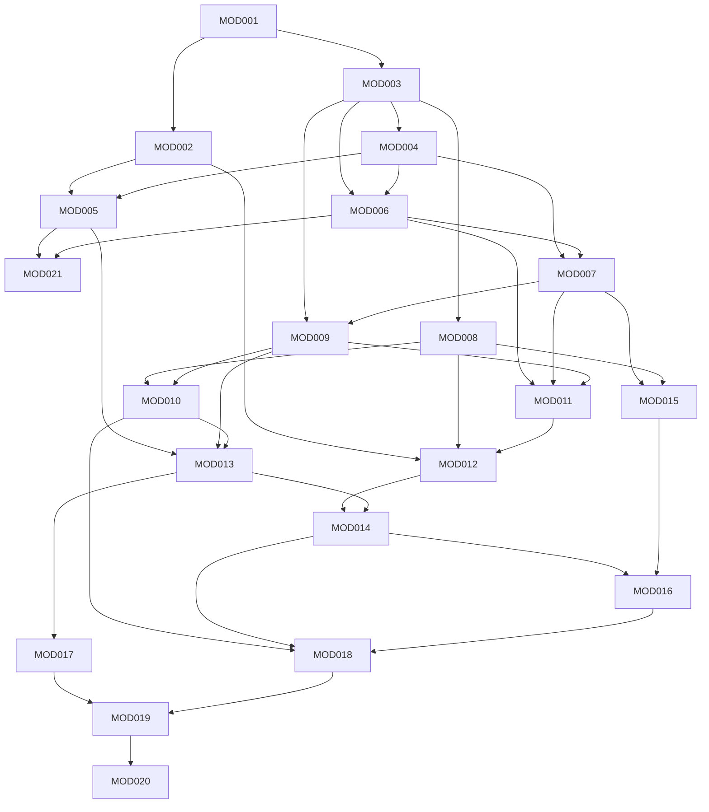

# Task dependency graph (MOD-001 to MOD-021)

Dependencies are those stated in `implementation_plan.md`. The native (NAT) and
large-deployment (SCALE) tracks start after the interfaces below exist and are
not drawn here.

## Tasks

"Wave" is the longest dependency chain from MOD-001. Tasks in the same wave have no
dependency on each other and can run in parallel (staffing permitting). A task may also
start early on its own dependencies without waiting for the whole previous wave.

| Task | Depends on | Wave | Owning directories / Bazel packages |
|---|---|---|---|
| MOD-001 | none | 0 | `docs/decisions`, `docs/plan` |
| MOD-002 | 001 | 1 | repo root, `//tools`, `//tools/visibility`, `//requirements`, `//waffle/contracts/foundation`, `//apps/cli`, `//third_party/{gdsfactory,beamz}` (pins, smoke tests) |
| MOD-003 | 001 | 1 | `//waffle/contracts/component`, `//waffle/contracts/models`, `//waffle/design/{components,instances}` |
| MOD-004 | 003 | 2 | `//waffle/contracts/geometry`, `//waffle/contracts/layout` |
| MOD-008 | 003 | 2 | `//waffle/artifacts` |
| MOD-005 | 002, 004 | 3 | `//third_party/gdsfactory` (adapter, worker), `//waffle/layout/{services,formats}` |
| MOD-006 | 003, 004 | 3 | `//waffle/technology`, `//waffle/contracts/physics`, `//waffle/geometry/services` |
| MOD-007 | 004, 006 | 4 | `//waffle/design/mappings` |
| MOD-021 | 005, 006 | 4 | `//waffle/contracts/layout`, `//waffle/layout/services`, `//waffle/geometry/services`, `//third_party/gdsfactory`, `//waffle/simulation/common` |
| MOD-009 | 003, 007 | 5 | `//waffle/models`, `//waffle/contracts/models` |
| MOD-015 | 007, 008 | 5 | `//waffle/experiments` (datasets), `//waffle/contracts/results` |
| MOD-010 | 008, 009 | 6 | `//waffle/experiments`, `//waffle/workflows` |
| MOD-011 | 006, 007, 009 | 6 | `//waffle/simulation/common`, `//waffle/simulation/photonics/device_analysis` |
| MOD-012 | 002, 008, 011 | 7 | `//third_party/beamz` (adapter, worker), `//waffle/execution` |
| MOD-013 | 005, 009, 010 | 7 | demonstration library (own distribution, see MOD-017); `//waffle/models` analytic models |
| MOD-014 | 012, 013 | 8 | `//waffle/simulation/photonics/characterization`, `//waffle/characterization` |
| MOD-017 | 013 | 8 | separate demo PDK and example distributions |
| MOD-016 | 014, 015 | 9 | `//waffle/characterization`, `//waffle/statistics` |
| MOD-018 | 010, 014, 016 | 10 | `//waffle/workflows`, `//waffle/execution`, `//validation/...` |
| MOD-019 | 017, 018 | 11 | `//apps/cli`, `//waffle/workflows`, `//environments`, packaging |
| MOD-020 | 019 | 12 | `//docs`, `//validation/component_model_lifecycle` |

## Parallelism

* After MOD-001: MOD-002 and MOD-003.
* After MOD-003: MOD-004 and MOD-008.
* MOD-005 (layout backend) and MOD-006 (technology) run in parallel once MOD-004 lands.
* MOD-009 and MOD-015 run in parallel after MOD-007 (MOD-015 also needs MOD-008).
* MOD-010 and MOD-011 run in parallel after MOD-009.
* MOD-014 and MOD-017 run in parallel; MOD-017 is not on the critical path.
* Critical path: 001, 003, 004, 006, 007, 009, 010 or 011, 012 or 013, 014, 016, 018, 019, 020.
